  

###

  
  

###

  

###

<h1 data-importer="text" align="center">Welcome to my GitHub page 👋</h1>

###

<h3 data-importer="text" align="left">👩‍💻  About Me</h3>

###

I'm Software Engineering student from Bulgaria.  - 🔭 I’m currently broadening my skills and searching for a job - 📚 I'm currently learning Go, Docker and Kubernetes - ⚡ In my free time I thinker with my NixOS machine or i am playing some games

###

<h3 data-importer="text" align="left">🛠 Language and tools</h3>

###

  
  
  
  
  
  
  
  
  
  
  
  
  
  
  
  
  
  
  
  
  
  
  
  
  
  
  
  
  
  
  
  
  

###

<picture data-importer="pacman">
  <source media="(prefers-color-scheme: dark)" srcset="https://raw.githubusercontent.com/nsgshsk/nsgshsk/pacman-output/bomberman-contribution-graph-dark.svg?game=bomberman">
  <source media="(prefers-color-scheme: light)" srcset="https://raw.githubusercontent.com/nsgshsk/nsgshsk/pacman-output/bomberman-contribution-graph.svg?game=bomberman">
  
</picture>

###

  

###

<h3 data-importer="text" align="left">🔥   My Stats :</h3>

###

  
  
  

###
